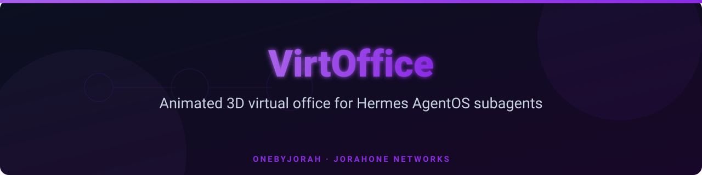
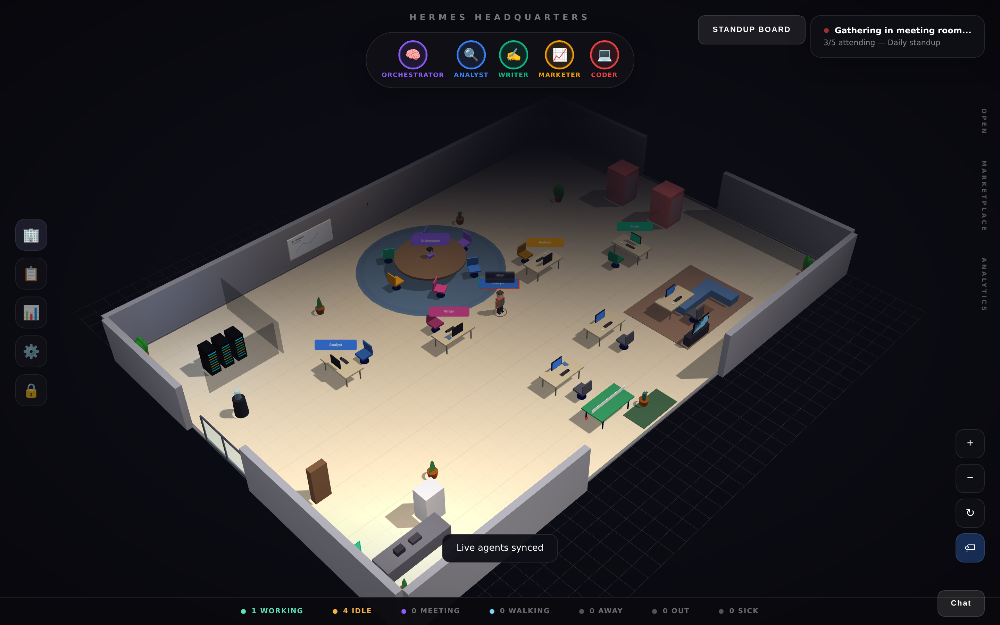
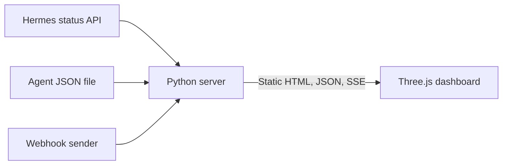

# Offivo

A 3D virtual office dashboard for agent status, served by Python with a static Three.js interface.

[](https://github.com/OneByJorah/offivo/actions/workflows/ci.yml)
[](LICENSE)



## Why this exists

Offivo displays agents, their tasks, and their activity in an animated office.
It can read a JSON file or poll a Hermes status API, and sends updates to the browser through Server-Sent Events (SSE).
The Python server uses only the standard library; no Node build or npm installation is required.

## Features

- 3D office view at `/office.html`, with agent status and task details.
- JSON state endpoint at `/api/agents` and configuration at `/api/config`.
- Hermes API polling, JSON file input, and demo fallback when neither source supplies data.
- Webhook updates at `POST /webhook/agents`, broadcast through `/events`.
- A single-service Docker Compose setup.

## Quick start

### From source

Use Python 3.11 or later. On Windows, use `py -3` if `python` is not on PATH.

```bash
git clone https://github.com/OneByJorah/offivo.git
cd offivo
python server.py
```

Open <http://127.0.0.1:9502/> for the landing page or
<http://127.0.0.1:9502/office.html> for the dashboard. Stop the server with Ctrl+C.
The server reads the repository's `agents.json` by default. Use a separate file for your own agents.
The browser loads Three.js from cdnjs and fonts from Google Fonts, so full rendering needs internet access.

### Docker Compose

From the repository directory, with Docker and Compose installed:

```bash
cp .env.example .env
docker compose up -d --build
```

In PowerShell, use `Copy-Item .env.example .env` for the copy step.
The same URLs above apply. Compose publishes only on `127.0.0.1`; `HOST=0.0.0.0`
in the example configuration is the bind address **inside the container**.
Compose mounts `./agents.json` read-only at `/app/agents.json`.

Stop the service with `docker compose down`.

## Configuration

The source command reads environment variables; it does **not** load `.env`.
Compose loads `.env` through `env_file`. Set variables in your shell when running Python directly.

| Variable | Source default | Purpose |
| --- | --- | --- |
| `HOST` | `127.0.0.1` | Server bind address; Compose defaults to `0.0.0.0` inside the container. |
| `PORT` | `9502` | HTTP port. |
| `AGENTS_JSON_PATH` | `agents.json` beside `server.py` | JSON file; prefer an absolute path for a custom file. |
| `HERMES_AGENT_API` | Empty | Optional HTTP endpoint returning an agent array or an object containing `agents` or `results`. |
| `POLL_INTERVAL_SECONDS` | `5` | Source refresh interval in seconds. |
| `ENABLE_SSE` | `true` | Broadcast live events; `1`, `true`, and `yes` enable broadcasting. |

An agent file can contain an array or an object with an `agents` array:

```json
{"agents": [{"id": "demo-worker", "name": "Demo Worker", "status": "working", "task": "Example task"}]}
```

The server normalizes omitted display fields. An empty array means no agents.
Each refresh tries the configured Hermes API, then the file, then built-in demo agents.
`/api/config` reports the configured source, not whether the last fetch succeeded.

`POST /webhook/agents` accepts an array or `{"agents": [...]}` and updates the in-memory
state immediately. The next polling refresh replaces that state from the configured source;
use file or API input for persistent updates. The server has no authentication, so keep it on loopback.
See [Hermes integration](docs/HERMES_INTEGRATION.md) for bridge details.

## Architecture



## Development checks

Create and activate a virtual environment, then run:

```bash
python -m pip install -r requirements-dev.txt
python -m ruff check server.py tests
python -m pytest -q
```

Tests start loopback servers with temporary synthetic data and exercise static pages,
configuration, agent state, webhook updates, SSE, and the Python entry point.
CI runs the same lint and test commands and fails if either fails.
The npm scripts are convenience wrappers for Python commands, not a JavaScript runtime package.

## Roadmap

Propose improvements through [issues](https://github.com/OneByJorah/offivo/issues).

## Contributing

See [CONTRIBUTING.md](CONTRIBUTING.md) and [AGENTS.md](AGENTS.md).

## Security

See [SECURITY.md](SECURITY.md) for reporting instructions.

## License

MIT; see [LICENSE](LICENSE).
